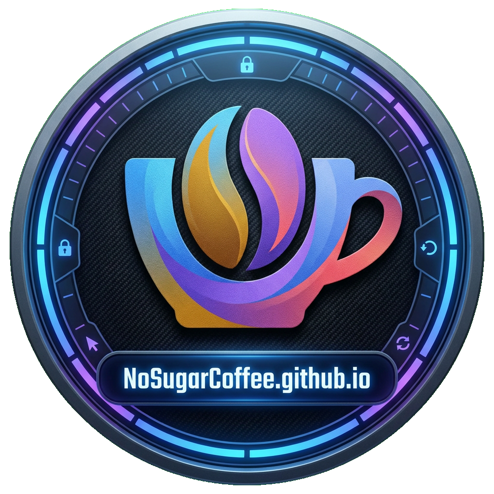

<div align="center">
  

  [](https://docusaurus.io/)
  [](LICENSE)
  [](https://NoSugarCoffee.github.io)
  [](https://nodejs.org)

  **☕ A personal dev blog — original tech articles, curated translations & weekly AI trending reports 📡**

  [🏠 Visit Blog](https://NoSugarCoffee.github.io) · [🌐 外刊翻译](https://NoSugarCoffee.github.io/translation) · [🤖 AI Trending](https://NoSugarCoffee.github.io/trending) · [🧩 Leetcode](https://nosugarcoffee.github.io/leetcode/)
</div>

---

## ✨ What's Inside

| Section | Description |
|---------|-------------|
| 📝 **技术原创** | Original technical articles on Go, Java, DevOps & more |
| 🌐 **外刊翻译** | Curated translations of top English engineering posts into Chinese |
| 🤖 **AI Trending** | Weekly analysis reports of trending AI repositories on GitHub |
| 🧩 **Leetcode** | Algorithm solutions and explanations |

---

## 🚀 Quick Start

```bash
# Install dependencies
npm install

# Start local dev server (http://localhost:3000)
npm start
```

## 🏗️ Build & Deploy

```bash
# Build for production
npm run build

# Serve the production build locally
npm run serve

# Deploy to GitHub Pages
npm run deploy

# Sync trending AI reports
npm run sync-reports
```

---

## 🗂️ Project Structure

```
.
├── blog/               # Original technical posts (技术原创)
├── translation/        # Translated articles (外刊翻译)
├── reports/            # Weekly AI trending reports
├── docs/               # Documentation pages
├── src/
│   ├── components/     # React components
│   ├── css/            # Custom styles
│   └── pages/          # Static pages
├── static/             # Static assets (images, icons)
└── docusaurus.config.js
```

---

## 🛠️ Tech Stack

- **[Docusaurus 3](https://docusaurus.io/)** — static site generator optimized for content-heavy sites
- **React 18** — component-based UI
- **GitHub Pages** — zero-cost hosting with custom domain support
- **MDX** — write JSX directly inside Markdown files

---

## 📄 License

MIT © [NoSugarCoffee](https://github.com/NoSugarCoffee)
